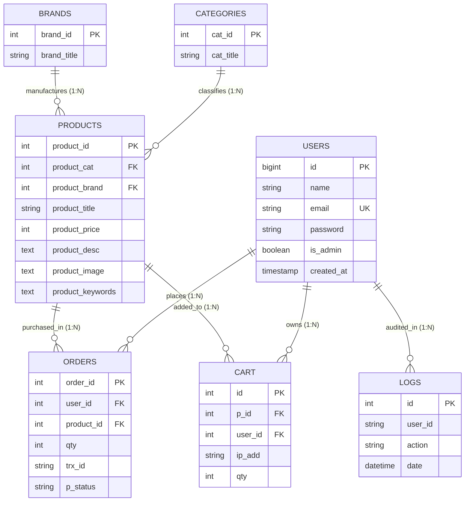

# PRODUCT REQUIREMENT DOCUMENT (PRD)
## MY-Store: Modern E-Commerce Management System

---

## DAFTAR ISI
1. [Identitas & Gambaran Umum Produk](#1-identitas--gambaran-umum-produk)
2. [Teknologi yang Digunakan (Tech Stack)](#2-teknologi-yang-digunakan-tech-stack)
3. [Arsitektur Sistem & Cara Kerja](#3-arsitektur-sistem--cara-kerja)
4. [Perancangan Basis Data & ERD](#4-perancangan-basis-data--erd)
5. [Alur Penggunaan Sistem (User Flow)](#5-alur-penggunaan-sistem-user-flow)
6. [Fitur-Fitur yang Ditawarkan](#6-fitur-fitur-yang-ditawarkan)
7. [Konsep & Desain Antarmuka (UI/UX)](#7-konsep--desain-antarmuka-uiux)
8. [Rangkuman Poin Materi untuk 10 Slide Presentasi (Canva)](#8-rangkuman-poin-materi-untuk-10-slide-presentasi-canva)

---

## 1. IDENTITAS & GAMBARAN UMUM PRODUK

### 1.1 Identitas Produk
* **Nama Produk:** MY-Store
* **Platform:** Web-based E-Commerce Application
* **Versi Rilis:** v2.0 (Laravel Refactored & Hardened Security Edition)
* **Kategori Produk:** Retail Online Komoditas Elektronik, Gadget, Pakaian, & Peralatan Rumah Tangga

### 1.2 Latar Belakang & Masalah
Banyak platform e-commerce skala kecil dan menengah menghadapi tantangan mendasar dalam aspek:
1. **Keamanan Transaksi & Akses Data:** Adanya celah *Insecure Direct Object Reference* (IDOR) pada keranjang belanja, kebocoran data keranjang antar tamu (*guest session hijack*), serta akses panel administratif yang tidak terisolasi secara ketat.
2. **Integritas Pencatatan Audit:** Minimnya pencatatan audit log transaksi di tingkat basis data (*database level*) sehingga data pembelian rentan dimanipulasi atau hilang saat aplikasi mengalami kegagalan proses di tingkat perantara (*middleware/application failure*).
3. **Pengalaman Pengguna (UX) yang Lambat & Rumit:** Sistem pencarian produk yang kaku dan tata letak katalog yang membingungkan pengunjung.

### 1.3 Visi & Solusi MY-Store
MY-Store dikembangkan sebagai solusi toko online modern yang menggabungkan:
* **Performa Tinggi:** Arsitektur MVC berbasis Laravel 12 dengan query database teroptimasi.
* **Keamanan Berlapis (Defense-in-Depth):** Penerapan *Role-Based Access Control* (RBAC), proteksi IDOR pada keranjang, serta transaksi atomik berstandar ACID.
* **Audit Trail Otomatis:** Pemanfaatan *Database Trigger* DBMS MySQL untuk pencatatan log pemesanan secara independen dan *real-time*.
* **UI/UX Modern & Responsif:** Antarmuka visual kontemporer dengan palet warna elegan, tipografi ramah mata, pencarian dinamis, dan navigasi ramah seluler.

---

## 2. TEKNOLOGI YANG DIGUNAKAN (TECH STACK)

MY-Store dibangun dengan tumpukan teknologi modern, stabil, dan teruji di lingkungan produksi:

| Komponen | Teknologi | Spesifikasi / Keterangan |
| :--- | :--- | :--- |
| **Bahasa Pemrograman** | PHP | Versi **8.2+** (Strict typing, performa tinggi dengan JIT & OpCache) |
| **Framework Backend** | Laravel Framework | Versi **12.0** (Arsitektur MVC, Eloquent ORM, Query Builder, Routing Engine) |
| **Database Management** | MySQL / MariaDB | Relational DBMS dengan dukungan *Foreign Key Constraints*, *ACID Transactions*, & *Triggers* |
| **Lingkungan Server** | XAMPP / Apache 2.4 | Web Server Apache terintegrasi dengan modul PHP & modul rewrite URL |
| **Frontend Core** | HTML5 & CSS3 | Semantik HTML5, modern flexbox, CSS grid, dan responsive media queries |
| **Design System** | Custom Vanilla CSS | CSS variables token (`--primary: #870000`, `--accent: #ffc107`), transisi mikro, glassmorphism |
| **Framework CSS Pembantu** | Bootstrap 5.3.0 | Digunakan pada Dashboard Admin dan Dashboard Pelanggan untuk utilitas grid & komponen modal |
| **Ikonografi & Tipografi** | Google Fonts & Icons | Font `Plus Jakarta Sans`, Font Awesome 6.4.0, Bootstrap Icons, serta Inline Vector SVG |
| **Keamanan Kredensial** | Bcrypt Hashing | Standar hashing kata sandi satu arah (*one-way salted hash*) |
| **Testing Suite** | PHPUnit 11.5 | Automated feature testing & security audit regression tests (16 tests, 52 assertions) |

---

## 3. ARSITEKTUR SISTEM & CARA KERJA

### 3.1 Pola Arsitektur MVC (Model - View - Controller)
Aplikasi memisahkan perhatian logika (*Separation of Concerns*) secara ketat menjadi tiga lapisan:

```
┌─────────────────────────────────────────────────────────────┐
│                       HTTP REQUEST                          │
└──────────────────────────────┬──────────────────────────────┘
                               │
                               ▼
┌─────────────────────────────────────────────────────────────┐
│                    ROUTING & MIDDLEWARE                     │
│    (routes/web.php | AdminMiddleware | Authenticate)        │
└──────────────────────────────┬──────────────────────────────┘
                               │
                               ▼
┌─────────────────────────────────────────────────────────────┐
│                         CONTROLLER                          │
│  (HomeController, CartController, AdminController, etc.)   │
└──────────────┬───────────────────────────────▲──────────────┘
               │                               │
               ▼                               │
┌──────────────────────────────┐ ┌─────────────┴──────────────┐
│     DATABASE & LOGIC         │ │      BLADE VIEW (UI)       │
│  - Query Builder / Eloquent  │ │  - home.blade.php          │
│  - DB::transaction (ACID)    │ │  - cart.blade.php          │
│  - MySQL Triggers            │ │  - admin.blade.php         │
└──────────────────────────────┘ └─────────────┬──────────────┘
                                               │
                                               ▼
┌─────────────────────────────────────────────────────────────┐
│                       HTTP RESPONSE                         │
└─────────────────────────────────────────────────────────────┘
```

1. **Model & Lapisan Data (`App\Models\User`, `DB::table`):**
   * Merepresentasikan entitas bisnis toko.
   * `User.php` mengelola autentikasi, atribut `$fillable`, *mass-assignment protection*, dan pengecekan otorisasi `isAdmin()`.
   * Operasi data relasional produk, keranjang, kategori, dan pesanan dieksekusi secara efisien menggunakan Laravel Query Builder berparameter (*PDO prepared statements*) untuk mencegah *SQL Injection*.
2. **View (`resources/views/`):**
   * Menggunakan Blade Templating Engine untuk merender antarmuka pengguna secara modular.
   * Mendukung kondisional Blade (`@auth`, `@if(Auth::user()->isAdmin())`, `@forelse`) untuk menyembunyikan dan menampilkan elemen UI sesuai hak akses pengguna.
3. **Controller (`app/Http/Controllers/`):**
   * Bertindak sebagai pengendali alur bisnis:
     * `HomeController`: Menangani penyaringan katalog multi-parameter dan penghitungan jumlah keranjang aktif.
     * `CartController`: Mengelola operasi CRUD keranjang belanja, validasi kepemilikan item (anti-IDOR), serta checkout pesanan.
     * `AdminController`: Mengelola dashboard administratif, pelaporan ringkasan metrik, dan operasi CRUD produk.
     * `UserController`: Mengagregasi data profil dan riwayat belanja personal.
     * `AuthController`: Menangani registrasi, login fleksibel (email atau username), serta terminasi sesi (logout).

### 3.2 Siklus Request-Response Lifecycle
1. **Pengguna Mengirim Permintaan (Request):** Klien mengirimkan HTTP Request (GET/POST) ke rute yang didefinisikan di `routes/web.php`.
2. **Penyaringan Middleware:**
   * `auth`: Memeriksa apakah pengguna memiliki sesi login aktif. Tamu (*guest*) yang mencoba mengakses keranjang atau checkout langsung dialihkan ke `/login` dengan notifikasi peringatan.
   * `admin` (`App\Http\Middleware\AdminMiddleware`): Memverifikasi bahwa atribut `is_admin == 1`. Jika pelanggan biasa mencoba mengakses `/admin`, sistem menghentikan akses dan mengembalikan pesan *Access Denied*.
   * `VerifyCsrfToken`: Memvalidasi token CSRF pada setiap permintaan berbasis POST untuk mencegah serangan *Cross-Site Request Forgery*.
3. **Pemrosesan di Controller:** Controller memvalidasi input data form (`$request->validate()`), melakukan kueri ke MySQL, dan memformat data.
4. **Respon HTML (Blade View):** Blade mengompilasi template HTML dengan data dinamis dan mengirimkannya ke browser klien dalam hitungan milidetik.

---

## 4. PERANCANGAN BASIS DATA & ERD

### 4.1 Entitas & Daftar Tabel Basis Data

Aplikasi menggunakan skema database relasional `ecommerce` yang terdiri dari 7 tabel utama:

#### 1. Tabel `users`
Menyimpan identitas kredensial dan hak akses akun.
* `id` (BIGINT, Primary Key, Auto Increment)
* `name` (VARCHAR 255): Nama pengguna / username
* `email` (VARCHAR 255, Unique): Alamat email pengguna
* `password` (VARCHAR 255): Kata sandi terenkripsi Bcrypt
* `is_admin` (BOOLEAN, Default: 0): Penentu peran (`0` = Pelanggan biasa, `1` = Administrator)
* `created_at`, `updated_at` (TIMESTAMP): Pencatatan waktu registrasi dan pembaruan

#### 2. Tabel `categories`
Menampung kelompok kategori komoditas barang.
* `cat_id` (INT, Primary Key, Auto Increment)
* `cat_title` (VARCHAR 255): Nama kategori (contoh: *Electronics, Mens Wear, Kids Wear, Home Appliances*)

#### 3. Tabel `brands`
Menampung merek produsen komoditas produk.
* `brand_id` (INT, Primary Key, Auto Increment)
* `brand_title` (VARCHAR 255): Nama produsen/merek (contoh: *Samsung, Apple, Sony, LG*)

#### 4. Tabel `products`
Katalog induk seluruh komoditas barang yang diperjualbelikan.
* `product_id` (INT, Primary Key, Auto Increment)
* `product_cat` (INT, Foreign Key $\rightarrow$ `categories.cat_id`): Relasi kategori produk
* `product_brand` (INT, Foreign Key $\rightarrow$ `brands.brand_id`): Relasi merek produk
* `product_title` (VARCHAR 255): Judul/nama produk
* `product_price` (INT): Nilai harga jual produk (dalam Rupiah)
* `product_desc` (TEXT): Deskripsi spesifikasi barang
* `product_image` (TEXT): Nama berkas aset gambar produk
* `product_keywords` (TEXT): Kata kunci pencarian produk

#### 5. Tabel `cart`
Menampung penampungan produk sementara sebelum transaksi diselesaikan.
* `id` (INT, Primary Key, Auto Increment)
* `p_id` (INT, Foreign Key $\rightarrow$ `products.product_id`): Produk yang dipilih
* `ip_add` (VARCHAR 250): Alamat IP asal permintaan
* `user_id` (INT, Foreign Key $\rightarrow$ `users.id`): ID pemilik keranjang (Wajib berelasi dengan pengguna terautentikasi)
* `qty` (INT, Default: 1): Kuantitas barang yang dipesan

#### 6. Tabel `orders`
Mencatat seluruh transaksi pembelian yang telah berhasil diselesaikan (*checkout*).
* `order_id` (INT, Primary Key, Auto Increment)
* `user_id` (INT, Foreign Key $\rightarrow$ `users.id`): Pembeli yang melakukan transaksi
* `product_id` (INT, Foreign Key $\rightarrow$ `products.product_id`): Produk yang dibeli
* `qty` (INT): Kuantitas barang yang dibeli
* `trx_id` (VARCHAR 255): Nomor unik transaksi (Format: `TRX-XXXXXXX`)
* `p_status` (VARCHAR 20): Status pembayaran/pesanan (contoh: *Completed*)

#### 7. Tabel `logs`
Tabel audit trail independen yang dikelola otomatis oleh trigger DBMS.
* `id` (INT, Primary Key, Auto Increment)
* `user_id` (VARCHAR 100): Identitas ID pembeli
* `action` (VARCHAR 255): Deskripsi tindakan transaksi yang terekam
* `date` (DATETIME): Waktu stempel eksekusi trigger (`NOW()`)

---

### 4.2 Entity Relationship Diagram (ERD)



---

### 4.3 Database Trigger Audit Trail (`trg_log_order_insert`)

Salah satu keunggulan arsitektural utama MY-Store adalah implementasi **Audit Trail Tingkat DBMS**. Sistem tidak hanya mengandalkan pencatatan log pada baris kode PHP, melainkan mempercayakan pencatatan audit integritas tinggi langsung kepada mesin basis data MySQL.

#### Definisi SQL Trigger Aktif:
```sql
CREATE TRIGGER trg_log_order_insert
AFTER INSERT ON orders
FOR EACH ROW
BEGIN
    INSERT INTO logs (user_id, action, date)
    VALUES (
        NEW.user_id, 
        CONCAT('Pemesanan Produk ID: ', NEW.product_id, ' Status: ', NEW.p_status), 
        NOW()
    );
END
```

#### Cara Kerja & Manfaat Trigger:
1. **Eksekusi Otomatis:** Setiap kali perintah `INSERT` berhasil dijalankan pada tabel `orders`, trigger akan langsung dieksekusi secara instan untuk tiap baris data (`FOR EACH ROW`).
2. **Keandalan Tinggi (Tamper-Resistant):** Sekalipun aplikasi mengalami *crash* sesaat setelah pesanan disimpan, data log tetap dijamin tercatat karena berada dalam satu siklus mesin basis data.
3. **Visibilitas Administrator:** Seluruh riwayat yang tercatat pada tabel `logs` ditampilkan secara *real-time* di panel **Admin Dashboard** pada tab *Audit Logs Trigger*.

---

## 5. ALUR PENGGUNAAN SISTEM (USER FLOW)

### 5.1 Alur Pengunjung Tamu (Guest User)
```
[Buka Homepage] ──► [Eksplorasi Katalog Produk] ──► [Cari & Filter Komoditas]
         │
         ▼
[Klik "Beli Sekarang"]
         │
         ▼
[Sistem Memeriksa Status Auth] ──► Belum Login?
         │
         ▼
[Dialihkan ke /login dengan Peringatan: "Silakan masuk ke akun Anda terlebih dahulu"]
         │
         ▼
[Login Berhasil] ──► [Produk Masuk Keranjang & Kembali Belanja]
```

### 5.2 Alur Pelanggan Terdaftar (Authenticated Customer)
1. **Autentikasi Fleksibel:** Pelanggan masuk melalui formulir login menggunakan **Email** (`yudo@email.com`) atau **Username** (`MYudo`) beserta kata sandi.
2. **Manajemen Keranjang Belanja:**
   * Pelanggan menekan tombol *Beli Sekarang* pada kartu produk.
   * Produk ditambahkan ke tabel `cart` dengan `user_id` milik pelanggan aktif.
   * Badge keranjang belanja di navbar atas bertambah secara *real-time*.
3. **Pemeriksaan & Modifikasi Keranjang (`/cart`):**
   * Pelanggan dapat mengubah kuantitas barang (*update quantity*) dengan batas aman (1-99).
   * Pelanggan dapat menghapus barang dari keranjang belanja.
   * Sistem menghitung akumulasi *subtotal* secara otomatis.
4. **Checkout Atomik (ACID Transaction):**
   * Pelanggan menekan tombol *Selesaikan Pesanan & Checkout*.
   * Sistem mengunci baris data (`lockForUpdate`), membuat kode unik transaksi (`TRX-XXXXXXX`), memindahkan data ke tabel `orders`, memicu eksekusi *DBMS Trigger*, dan mengosongkan keranjang belanja.
5. **Dashboard Riwayat Belanja (`/user-dashboard`):**
   * Pelanggan diarahkan ke dashboard akun personal untuk melihat total akumulasi belanja, kuantitas item, serta tabel riwayat pemesanan lengkap dengan gambar thumbnail produk.

### 5.3 Alur Administrator (Store Administrator)
```
[Login dengan Akun Admin] (is_admin = 1)
         │
         ▼
[Navbar Menampilkan Tombol 🛡 Admin]
         │
         ▼
[Akses /admin Dashboard]
         ├──► [Memantau 4 Statistik Utama: Total Produk, Pesanan, User, Audit Logs]
         ├──► [CRUD Tambah Produk Baru via Modal Form]
         ├──► [CRUD Update Harga, Kategori, Merek, & Gambar Produk]
         ├──► [CRUD Hapus Produk (Dilindungi Validasi Integritas Foreign Key)]
         └──► [Memantau Live Audit Trail Logs Hasil Eksekusi Trigger DBMS]
```

---

## 6. FITUR-FITUR YANG DITAWARKAN

### 6.1 Pencarian Multi-Kriteria Dinamis (Dynamic LIKE Query)
Pencarian di halaman utama tidak hanya mencocokkan judul produk, melainkan memeriksa 4 parameter basis data sekaligus secara fleksibel:
```sql
SELECT products.*, categories.cat_title, brands.brand_title
FROM products
LEFT JOIN categories ON products.product_cat = categories.cat_id
LEFT JOIN brands ON products.product_brand = brands.brand_id
WHERE (
    products.product_title LIKE '%keyword%' OR
    products.product_keywords LIKE '%keyword%' OR
    categories.cat_title LIKE '%keyword%' OR
    brands.brand_title LIKE '%keyword%'
)
```
* **Fitur Pelengkap:** Tombol *Clear Filter* (✕) yang muncul secara otomatis ketika pencarian sedang aktif untuk memudahkan pengguna kembali ke katalog utama dalam satu klik.

### 6.2 Shopping Cart Badge & Proteksi IDOR
* **Live Counter Badge:** Menampilkan jumlah total akumulasi kuantitas barang belanjaan secara langsung di atas ikon keranjang belanja pada navbar.
* **Proteksi IDOR (Insecure Direct Object Reference):** Pengguna jahat tidak dapat memanipulasi atau menghapus barang di keranjang milik pengguna lain melalui parameter ID, karena seluruh operasi diikat dengan kondisi ketat:
  ```php
  DB::table('cart')->where('id', $cartId)->where('user_id', Auth::id())->update(...);
  ```

### 6.3 Transaksi Checkout Atomik & Kepatuhan ACID
Proses checkout dilindungi oleh `DB::transaction()` dengan isolasi transaksi penuh:
1. **Atomicity:** Jika terjadi kesalahan pada saat memindahkan salah satu item keranjang ke pesanan, seluruh perubahan dibatalkan (*rollback* otomatis) tanpa meninggalkan data menggantung.
2. **Consistency:** Menjamin kuantitas barang dan data nominal rupiah selalu valid dan sinkron.
3. **Isolation (`lockForUpdate`):** Mencegah serangan *Race Condition* atau *double-checkout* saat pengguna menekan tombol checkout berkali-kali secara bersamaan.
4. **Durability:** Data pesanan langsung tercatat permanen di database dan memicu trigger audit trail.

### 6.4 Dashboard Administrator & CRUD Komoditas
* **Metrik Bisnis Cepat:** Kartu ringkasan jumlah komoditas produk, akumulasi transaksi penjualan, total akun terdaftar, dan jumlah rekaman audit log.
* **Modal Form Interaktif:** Tambah dan edit produk dilakukan melalui dialog pop-up modal tanpa meninggalkan konteks halaman.
* **Perlindungan Integritas Referensial:** Tombol hapus produk dilengkapi verifikasi keamanan. Jika produk pernah dipesan dalam tabel `orders`, sistem menolak penghapusan untuk menjaga keutuhan riwayat laporan keuangan.

### 6.5 Dashboard Pelanggan Personal
* Menampilkan profil ringkas pengguna yang sedang masuk.
* Tiga kartu ringkasan personal: *Total Pesanan Transaksi*, *Total Unit Produk Dibeli*, dan *Akumulasi Total Belanja (Rp)*.
* Tabel riwayat pesanan kronologis dari yang terbaru hingga terlama, dilengkapi status transaksi dan tautan kembali belanja.

---

## 7. KONSEP & DESAIN ANTARMUKA (UI/UX)

### 7.1 Identitas Visual & Palet Warna
Desain MY-Store dirancang untuk memberikan kesan toko komoditas premium, modern, dan terpercaya:

| Peran Warna | Kode HEX | Nilai RGB | Penggunaan Antarmuka |
| :--- | :--- | :--- | :--- |
| **Primary Red** | `#870000` | `rgb(135, 0, 0)` | Warna dasar brand, tombol utama (CTA), header toko, kartu sorotan |
| **Primary Dark** | `#630000` | `rgb(99, 0, 0)` | Efek hover tombol, footer background, gradien navbar |
| **Accent Gold** | `#ffc107` | `rgb(255, 193, 7)` | Ikon tas belanja SVG, teks `STORE` pada logo, badge counter, highlight admin |
| **Surface Light** | `#f8fafc` | `rgb(248, 250, 252)` | Latar belakang halaman toko & kontainer produk |
| **Card Border** | `#e2e8f0` | `rgb(226, 232, 240)` | Garis batas kartu produk, input form, dan pemisah tabel |
| **Text Dark** | `#0f172a` | `rgb(15, 23, 42)` | Tipografi judul utama, harga produk, dan label penting |
| **Text Muted** | `#64748b` | `rgb(100, 116, 139)` | Deskripsi produk, kategori badge, dan teks petunjuk placeholder |

### 7.2 Tipografi & Ikonografi
* **Font Utama:** `Plus Jakarta Sans` (Google Fonts) dengan bobot 400 (Regular), 600 (Semi-Bold), 700 (Bold), dan 800 (Extra-Bold). Font geometris modern ini menawarkan tingkat keterbacaan (*readability*) yang sangat tinggi pada berbagai resolusi layar.
* **Ikon Brand Logo:** Ikon tas belanja SVG vektor presisi tinggi dengan aksen kuning emas yang menyatu harmonis dengan teks `MY-STORE`.

### 7.3 Hierarki Antarmuka Beranda (`home.blade.php`)
1. **Top Navigation Bar:**
   * Sisi Kiri: Logo interaktif `MY-STORE` dengan ikon tas belanja.
   * Sisi Kanan: Live Shopping Cart Badge, sapaan personal pengguna, tombol Dashboard, tombol khusus Admin (jika memiliki peran admin), dan tombol Login/Logout.
2. **Hero Header:**
   * Judul besar berwibawa: **Welcome to MY-Store**.
3. **Pusat Pencarian & Filter (Filter Center):**
   * Bilah pencarian melengkung modern (*pill-shaped input*) dengan ikon kaca pembesar dan tombol aksi cepat.
   * Baris tombol cepat kategori (*Quick Category Pills*) untuk menyaring komoditas dalam satu ketukan jari.
4. **Grid Komoditas Unggulan (Category Highlight Cards):**
   * Menampilkan visual kategori terpopuler (*Electronics Gadgets, Fashion & Wears, Apple & Smartphones*) dengan tombol aksi cepat *Belanja Sekarang*.
5. **Katalog Produk Utama (Product Cards Grid):**
   * Kartu produk berdesain modern dengan efek elevasi hover (*subtle shadow lift*).
   * Menampilkan badge ID produk, kategori, foto berkualitas tajam, judul jelas, label harga berformat Rupiah (`Rp XX.XXX.XXX`), dan tombol beli merah menyala.
6. **Footer Komprehensif:**
   * Informasi profil toko, tautan cepat kategori, tautan layanan pelanggan, dan hak cipta platform.

---

## 8. RANGKUMAN POIN MATERI UNTUK 10 SLIDE PRESENTASI (CANVA)

Dokumen ini disusun secara modular agar dapat langsung dituangkan ke dalam **10 slide presentasi Canva** yang padat, menarik, dan berdaya pikat tinggi:

```
┌────────────────────────────────────────────────────────────────────────────┐
│                    STRUKTUR SLIDE PRESENTASI (MAKSIMAL 10 SLIDE)           │
├─────────┬──────────────────────────────────────────────────────────────────┤
│ Slide 1 │ Judul & Identitas Produk: "MY-Store Modern E-Commerce Platform"  │
│ Slide 2 │ Latar Belakang & Masalah Bisnis yang Diselesaikan                │
│ Slide 3 │ Arsitektur Sistem & Alur Kerja MVC Laravel 12                    │
│ Slide 4 │ Tumpukan Teknologi Terpadu (Tech Stack)                          │
│ Slide 5 │ Perancangan Basis Data Relasional & Entity Relationship Diagram  │
│ Slide 6 │ Keamanan Tingkat Lanjut & DBMS Trigger Audit Trail               │
│ Slide 7 │ Alur Pengguna: Pengunjung, Pelanggan, & Administrator            │
│ Slide 8 │ Fitur Unggulan: Pencarian Dinamis, Keranjang & Checkout Atomik   │
│ Slide 9 │ Konsep Desain Antarmuka (UI/UX) & Estetika Visual                │
│ Slide 10│ Kesimpulan, Manfaat Bisnis, & Rencana Pengembangan Masa Depan    │
└─────────┴──────────────────────────────────────────────────────────────────┘
```

---

### **Slide 1: Judul & Identitas Produk**
* **Judul Utama:** MY-Store: Platform E-Commerce Modern Berbasis Laravel 12 & MySQL
* **Sub-judul:** Solusi Manajemen Toko Online Cepat, Aman, dan Terintegrasi dengan Audit Trail Basis Data
* **Identitas Visual:** Logo resmi `MY-STORE` dengan ikon tas belanja warna emas.
* **Poin Utama:**
  * Transformasi toko online konvensional menuju sistem e-commerce berarsitektur MVC modern.
  * Menawarkan pengalaman belanja instan untuk berbagai komoditas elektronik dan gaya hidup.
  * Disajikan oleh: Tim Pengembang E-Commerce.

---

### **Slide 2: Latar Belakang & Masalah Bisnis**
* **Judul Slide:** Mengapa Platform Ini Dibangun?
* **Tantangan yang Dihadapi Toko Online Saat Ini:**
  * **Kerentanan Akses Tamu & IDOR:** Celah keamanan pada sesi keranjang belanja dan manipulasi ID transaksi.
  * **Pemisahan Peran yang Lemah:** Tidak adanya isolasi ketat antara hak akses pembeli dan administrator toko.
  * **Hilangnya Jejak Audit Transaksi:** Ketiadaan pencatatan log otomatis di tingkat database jika sistem aplikasi mengalami galat.
  * **Katalog & Pencarian yang Kaku:** Pengunjung kesulitan menemukan produk yang relevan secara cepat.
* **Nilai Manfaat:** MY-Store hadir menyelesaikan seluruh masalah tersebut melalui standar keamanan baku dan efisiensi basis data.

---

### **Slide 3: Arsitektur Sistem & Alur MVC Laravel 12**
* **Judul Slide:** Arsitektur Sistem Berkinerja Tinggi
* **Poin Kunci:**
  * **Model-View-Controller (MVC):** Pemisahan tegas antara basis data, antarmuka visual, dan logika bisnis.
  * **Siklus Request-Response:** Permintaan HTTP klien melewati filter Middleware (`auth`, `admin`, CSRF token) sebelum dieksekusi controller.
  * **Keamanan Kueri:** Seluruh operasi data menggunakan Query Builder dengan *Prepared Statements* (Bebas celah SQL Injection).
  * **Blade Engine:** Penyajian antarmuka reaktif dan kondisional berdasarkan status autentikasi pengguna.

---

### **Slide 4: Tumpukan Teknologi Terpadu (Tech Stack)**
* **Judul Slide:** Fondasi Teknologi yang Digunakan
* **Komposisi Stack:**
  * **Backend Core:** PHP 8.2+ dengan Framework **Laravel 12.0**.
  * **Database Engine:** MySQL / MariaDB (Dukungan penuh Relasional, Transaksi ACID, & Trigger).
  * **Frontend & Desain:** Semantik HTML5, Custom Vanilla CSS Design System, Bootstrap 5.3 (Dashboard).
  * **Tipografi & Ikon:** Google Fonts `Plus Jakarta Sans`, Font Awesome 6, Bootstrap Icons, Vector SVG.
  * **Lingkungan Deploy:** Apache 2.4 Server (XAMPP Environment).

---

### **Slide 5: Perancangan Basis Data Relasional & ERD**
* **Judul Slide:** Struktur Basis Data & Hubungan Antar Tabel
* **Struktur 7 Tabel Inti:**
  * `users` $\rightarrow$ Akun pelanggan & otorisasi peran (`is_admin`).
  * `categories` & `brands` $\rightarrow$ Taksonomi pengelompokan produk.
  * `products` $\rightarrow$ Katalog komoditas barang dagangan.
  * `cart` $\rightarrow$ Penampungan barang belanjaan pengguna terautentikasi.
  * `orders` $\rightarrow$ Catatan transaksi pembelian yang telah selesai.
  * `logs` $\rightarrow$ Riwayat audit trail transaksi sistem.
* **Hubungan Relasi (Foreign Key Constraints):** Integritas data terjaga dengan relasi satu-ke-banyak (1:N) dari pengguna ke pesanan dan produk ke pesanan.

---

### **Slide 6: Keamanan Tingkat Lanjut & DBMS Trigger Audit Trail**
* **Judul Slide:** Standar Keamanan Berlapis & Audit Trail Otomatis
* **Pilar Keamanan Utama:**
  * **Role-Based Access Control (RBAC):** Pemisahan hak akses admin dan pengguna biasa via middleware khusus.
  * **Proteksi IDOR Keranjang:** Validasi kepemilikan item berdasarkan `user_id` aktif pada setiap request.
  * **Enkripsi Kata Sandi:** Hashing satu arah menggunakan algoritma Bcrypt ber-salt.
* **Database Trigger `trg_log_order_insert`:**
  * Berjalan otomatis saat `AFTER INSERT ON orders`.
  * Menjamin pencatatan audit log transaksi bersifat permanen, instan, dan anti-manipulasi.

---

### **Slide 7: Alur Pengguna (User Flow)**
* **Judul Slide:** Alur Interaksi Pengguna & Administrator
* **Alur Pelanggan:**
  * Masuk Beranda $\rightarrow$ Cari/Filter Produk $\rightarrow$ Tambah ke Keranjang $\rightarrow$ Sesuaikan Kuantitas $\rightarrow$ Checkout Atomik $\rightarrow$ Pantau Riwayat di Dashboard.
* **Alur Administrator:**
  * Login dengan Akun Admin $\rightarrow$ Akses Terbuka ke Tombol `🛡 Admin` $\rightarrow$ Pantau Ringkasan Bisnis $\rightarrow$ Manajemen CRUD Produk $\rightarrow$ Tinjau Audit Log Sistem.
* **Pengalihan Tamu (Guest Guard):** Tamu yang ingin berbelanja langsung diarahkan ke halaman login secara aman dan ramah pengguna.

---

### **Slide 8: Fitur Unggulan Sistem**
* **Judul Slide:** Fitur-Fitur Andalan MY-Store
* **1. Pencarian Multi-Parameter Dinamis:** Pencocokan teks nama, kata kunci, kategori, dan merek secara simultan (*LIKE Query*).
* **2. Shopping Cart Real-Time Badge:** Indikator kuantitas keranjang belanja yang otomatis terakumulasi.
* **3. Checkout Atomik Berstandar ACID:** Eksekusi pemindahan item keranjang ke pesanan menggunakan transaksi terisolasi (`DB::transaction`) dan penguncian baris (`lockForUpdate`).
* **4. Manajemen CRUD Produk Terpadu:** Tambah, edit, dan hapus barang dengan proteksi integritas pesanan.
* **5. Dashboard Profil Pelanggan:** Rangkuman total belanja dan riwayat pesanan kronologis.

---

### **Slide 9: Konsep Desain Antarmuka (UI/UX)**
* **Judul Slide:** Estetika Visual & Pengalaman Pengguna
* **Karakteristik Desain:**
  * **Palet Warna Mewah:** Sentuhan *Dark Crimson Red* (`#870000`) berpadu dengan aksen *Golden Yellow* (`#ffc107`).
  * **Tipografi Modern:** Teks jelas, elegan, dan mudah dibaca menggunakan font *Plus Jakarta Sans*.
  * **Mikro-Interaksi Dinamis:** Animasi elevasi kartu saat disentuh kursor (*hover lift effect*), dialog form modal yang responsif, dan layout ramah gawai seluler (*mobile-first*).
  * **Penyajian Harga Informatif:** Format mata uang Rupiah standar Indonesia yang bersih dan rapi.

---

### **Slide 10: Kesimpulan & Rencana Pengembangan Masa Depan**
* **Judul Slide:** Kesimpulan & Roadmap Pengembangan
* **Kesimpulan:**
  * MY-Store berhasil menghadirkan solusi e-commerce yang cepat, aman dari celah manipulasi transaksi, dan memiliki pencatatan audit tingkat basis data yang kokoh.
  * Kode program telah teruji secara komprehensif melalui 16 uji fitur otomatis dengan status 100% lolos (*PASS*).
* **Rencana Pengembangan Selanjutnya (Roadmap):**
  * Integrasi Payment Gateway resmi (Midtrans / Xendit).
  * Integrasi API Kurir & Ekspedisi Pengiriman barang (RajaOngkir).
  * Fitur unggah foto produk langsung dari antarmuka admin (*file upload storage*).
  * Sistem notifikasi transaksi otomatis melalui Email dan WhatsApp.

---
*Dokumen ini disusun sebagai acuan teknis resmi arsitektur perangkat lunak MY-Store dan siap digunakan sebagai panduan pembuatan materi presentasi Canva.*
